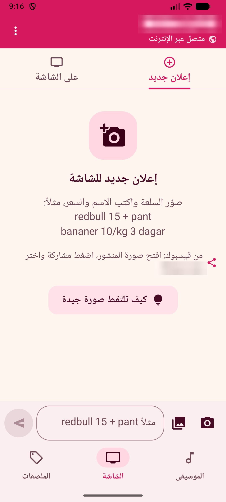
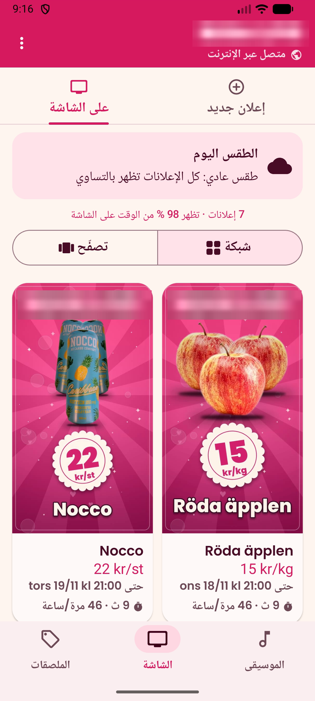
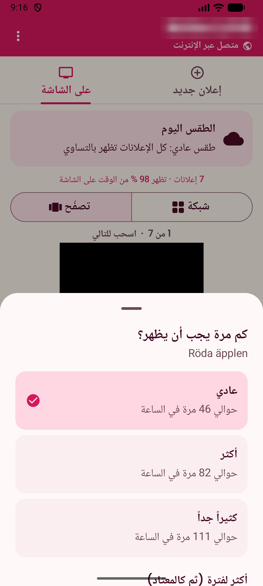
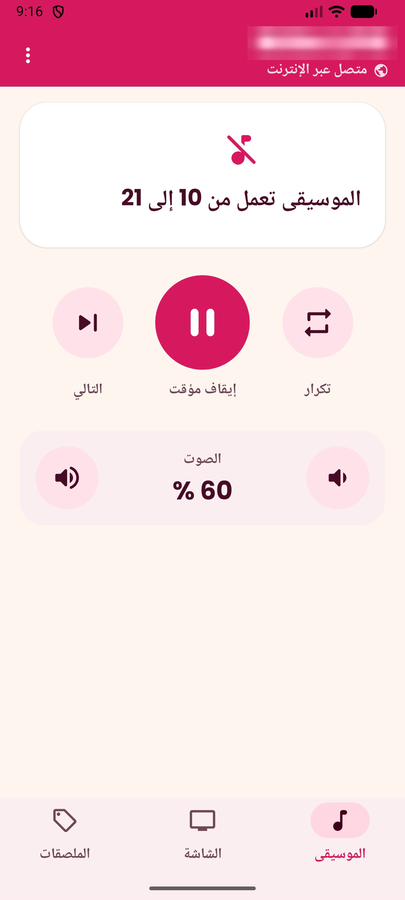
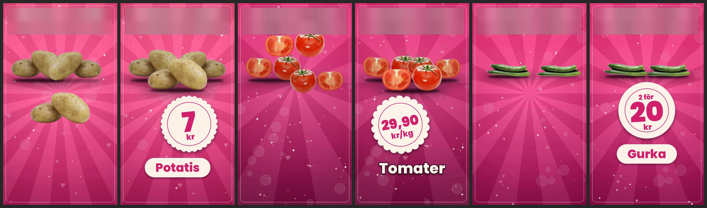
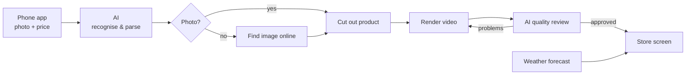
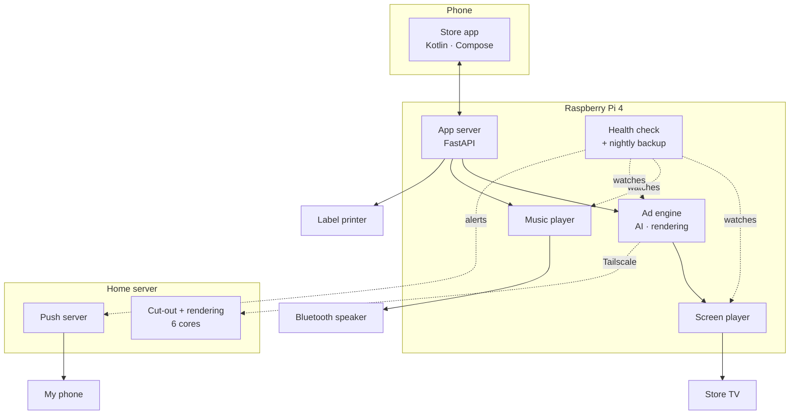

# Store screen

### Snap a photo. Type a price. Watch it go live on the store's screen.

An all-in-one system for a small grocery store: **AI-made video ads**, **store music**, **price labels**
and **self-monitoring**, controlled from one simple phone app and running on a single Raspberry Pi.

 

*A real ad, made automatically from one line of text: `potatis 7` ("potatoes 7 kr")*

---

## Contents

[The story](#the-story) · [A day in the store](#a-day-in-the-store) · [Features](#features) ·
[What's new](#whats-new) · [Screenshots](#screenshots) · [How an ad is made](#how-an-ad-is-made) ·
[Architecture](#architecture) · [Reliability](#built-to-run-without-me) · [Performance](#performance) ·
[Problems I solved](#problems-i-solved-along-the-way)

---

## The story

My dad runs a small grocery store. The store has a TV screen for offers, but making
an ad for it meant finding a photo, opening an editor, typing prices, exporting a video and copying it over.
In practice that meant: *call Mohammad.*

So I built him a system where he opens an app, takes a photo (or doesn't), types the price and taps **Publish**.
Two minutes later a polished video ad is playing on the screen in the store.

The one rule I built everything around:

> **It has to work on its own, so my dad never has to call me.**

That rule shaped every decision: plain language instead of error codes, big buttons instead of menus,
and a server that watches itself, fixes what it can and tells him in simple words when it can't.

> This repository is a showcase only. The source code is private.

---

## A day in the store

| Time | What happens, automatically |
|:---:|---|
| **03:30** | A nightly backup of every setting, ad and playlist is made |
| **Night** | New (shorter) songs are found, and the AI listens to find where the singing starts · product images are prepared in advance |
| **Opening** | Music starts in the morning time block with a fresh order for the day |
| **Morning** | Dad types `bananer 19 kr/kg` (bananas, 19 kr per kilo), taps the photo he likes best and then Publish |
| **Midday** | It's warm out, so cold drinks get more screen time · a few price labels are printed |
| **Afternoon** | The health check notices the label printer is off and says so in the app, in plain Swedish |
| **Closing** | Music stops · offers that ended today are archived (never deleted) |

---

## Features

<table>
<tr>
<td width="50%" valign="top">

### AI video ads
- Photo **or just text** a polished video, **6 to 30 seconds** long
- No photo? It **finds a product image online**, cuts it out and arranges it
- AI recognises the product and understands Swedish price formats like `kr/kg` (per kilo), `2 för` (2 for) and `+ pant` (plus bottle deposit)
- **Pick your favourite photo**: 4 product images appear right away, tap one (or ask for more)
- Typos are fixed automatically: `apelsint` becomes **Apelsiner** (oranges), `redbull` becomes **Red Bull**
- AI **reviews every video** and fixes problems before anyone sees it
- **Every ad looks unique**: colours, badge, layout and animations change each time
- Change an ad's length later and it is **re-rendered and swapped live** on the screen

</td>
<td width="50%" valign="top">

### Smart scheduling
- **Weather-aware**: cold drinks show more on hot days, warm food on cold days
- Choose **how often** an ad shows, with a live "≈ times per hour" estimate
- Choose **how long** each showing lasts
- Run ads for a few days or **until further notice**
- Expired ads are archived automatically, never deleted

</td>
</tr>
<tr>
<td valign="top">

### Store music
- Classic Arabic music in time blocks over the day
- A **fresh order every day**, no repeats until everything has played
- **Album covers** and a big, simple player as the home screen
- **Starts where the singing starts**: AI listens to every song and skips long intros and applause
- **Favourites** come up more often and are never rotated out
- Prefers **shorter songs**, so the store never sits through a 70-minute concert
- New songs are found and added automatically every night

</td>
<td valign="top">

### Weekly flyer
- Pick up to **10 photos**: the AI reads every product name and price
- Bad photos are swapped for clean product images automatically
- One tap to **share to Facebook** with ready-made text

### Price labels
- Type a name and price, or **snap a photo** and let the AI read the product
- Prints to a **Bluetooth label printer**
- Keeps the printer awake so it is always ready

</td>
</tr>
<tr>
<td valign="top">

### Store computer health
- Temperature, CPU, memory and disk, live in the app
- Is the screen running? Is the speaker connected? One glance tells you
- Hidden behind a developer mode (tap the version 7 times), so dad only sees what he needs

</td>
<td valign="top">

### Safety net
- **Report a problem** button: dad writes what's wrong and I get a push notification instantly
- **Updates arrive inside the app**: no more sending APK files around
- **Nightly backup** of everything that is hard to redo
- Big media files are skipped, so backups stay small
- The health check warns if a backup is ever missed
- Nothing is ever deleted: old files are archived

</td>
</tr>
</table>

### Built for my dad
- **Swedish and Arabic**, with full right-to-left layout
- Three big tabs at the bottom (**Music, Ads, Labels**) and a calm, readable design
- Opens **instantly**: it finds the store in the background
- Big touch targets, a **simple mode**, and plain language everywhere
- **"Share to the store"** from any app (a photo from Facebook becomes an ad)
- Finds the store by itself and **reconnects automatically**
- Live progress while it works: *"Searching for images…", "Cutting out image 2 of 3…"*

---

## What's new

| Version | Highlights |
|:---:|---|
| **1.8** | **Weekly flyer for Facebook**: pick up to 10 photos and the store reads every name and price by itself · clean product images even when the photo has a price tag or is a screenshot · the right variety in the pictures (green grapes stay green) · **quiet by design**: push alerts only when something really needs a human, via my **own notification server** with a public fallback · printer reconnects at most 3 times a day so the music never stutters · an **all-day screen profiler** to hunt down "it lags sometimes" |
| **1.7** | New **Weekly flyer** tab · AI swaps bad photos for better images · share to Facebook with ready-made text · quick typing: `räkor 85,98 ord 112,98` ("prawns 85.98, regular price 112.98") · bigger ad preview · faster start and connect |
| **1.6** | Photos cut out and **videos rendered on my home server** (16 s instead of 1–2 min, the Pi takes over if it's down) · AI check of the video **5× faster** · TV turns itself on in the morning and back on if it switches off · label printer stays connected without music dropouts · full-screen ad preview |
| **1.5** | Ads about **twice as fast** · every song starts where the singing starts · shorter songs · typo fixing |
| **1.4** | Calmer design · tabs back at the bottom · **Report a problem** · developer-only system info |
| **1.3** | Music-first home screen with album covers · **pick the product photo yourself** · in-app updates · instant start |
| **1.2** | Ad length per ad · song start position · favourites · store computer status · nightly backup |

<b> Earlier versions</b>

- **1.1** · automatic reconnect, clearer error messages, smoother video previews, many small fixes from real use
- **1.0** · AI ads, weather scheduling, store music, price labels, Swedish and Arabic

---

## Screenshots

| New ad | On screen | How often | Music |
|:---:|:---:|:---:|:---:|
|  |  |  |  |

*Shown here in Arabic, one of the app's two languages.*

### Every ad gets its own look

---

## How an ad is made

<b>Step by step</b>

1. **Understand.** `cola 2 för 25 + pant` ("cola, 2 for 25 kr, plus deposit") becomes a product, a deal type and a price. The AI also decides
   if it's a drink, fruit, a warm dish… which later drives the weather scheduling.
2. **Find images.** If there's no photo, several image searches run with fallbacks. Each candidate is scored
   for sharpness, angle and (for fruit and vegetables) how fresh it looks. The best four are shown in the app.
3. **Pick and cut out.** Dad taps the one he likes. Only that one has its background removed (the slow part),
   so he never waits for photos he won't use.
4. **Design.** A layout is chosen that never repeats the previous ad's style: colours, badge shape,
   product arrangement and animations all vary.
5. **Render.** Every frame is drawn in Python and encoded with FFmpeg, pre-rotated for the portrait screen.
6. **Review.** The AI looks at frames from the finished video, like a designer would. Cut-off products,
   unreadable prices or bad cut-outs send it back for one more round.
7. **Publish.** The file is swapped onto the screen without a gap, and the schedule is updated.

---

## Architecture

| Layer | Tech |
|---|---|
| **Phone app** | Kotlin, Jetpack Compose, Material 3, Media3, WorkManager |
| **Server** | Python, FastAPI, async background jobs |
| **Video** | Pillow for every frame, FFmpeg for encoding, hardware-decoded playback |
| **Image AI** | Background removal (rembg), product detection and image scoring |
| **Language AI** | Google Gemini with automatic fallback between models |
| **Music** | mpv controlled over IPC, weighted shuffle |
| **Weather** | SMHI (Swedish weather service) forecasts |
| **Hardware** | Raspberry Pi 4, TV screen, Bluetooth speaker, Bluetooth label printer |

---

## Built to run without me

A system in a real store has no one watching it. So it watches itself:

- **Health checks** look at the screen, music, speaker, printer, disk and temperature, and report problems in plain language.
- **Quiet by design**: no "all OK" spam. A push only arrives when something is broken *and* needs a human; evening music hiccups and an idle printer are ignored.
- **An AI on night watch**: four times a day an AI agent inspects the store computer (read-only) and only speaks up if something is wrong, with exact steps to fix it.
- **Bluetooth that heals itself**: if the radio chip hangs (it happens), a watchdog resets the driver within two minutes so the music comes back on its own.
- **Alarms never get lost**: alerts go to my own push server first, and to a public one if it doesn't answer.
- **A "Report a problem" button** sends dad's message straight to my phone as a push notification.
- **Updates ship through the app**: a new version shows up as a banner with one Update button.
- **Self-restarting services**: if something crashes, it comes back on its own.
- **The app reconnects by itself** when the phone switches between Wi-Fi and mobile data.
- **Nothing is deleted.** Old ads, old videos and replaced files are archived, so every mistake can be undone.
- **Backups every night**, with a warning if one is ever missed.
- **Heavy work never steals from the store**: rendering runs at the lowest priority on its own CPU cores.
- **Every change is tested before it goes live**, with automatic test suites for the API, the music and the ad pipeline.
- **Secrets stay secret**: keys live in one locked-down file that is never backed up, logged or committed.

---

## Performance

Everything runs on **one Raspberry Pi 4**: the screen, the music, the app server and the video rendering.

| Worst-case stress test (16 min, everything at once) | Result |
|---|:---:|
| Dropped video frames on the store screen | **0** |
| Music interruptions | **0** |
| Max CPU temperature | **71 °C** (no throttling) |
| Publish a finished ad | **≈ 2 s** |
| Video encoding per ad | **44 s 22 s** |
| Nightly backup size | **≈ 8 MB** |

---

## Problems I solved along the way

<b> The stuttering screen</b>

The TV dropped ~20 frames per second during transitions. Profiling showed the Pi was rotating every frame
in software. Rendering videos **pre-rotated** and in a hardware-friendly format took it to **zero dropped frames**.

<b> Bad product images</b>

Image search loves cartoons, watermarks and sad-looking bananas. I built a multi-step search with fallbacks,
a scoring step, a **freshness check** for fruit and vegetables, and a nightly job that prepares images for
common products in advance.

<b> Every ad looked the same</b>

Customers stop noticing an ad that looks like the last one. A variation system now picks colours, badge,
layout and motion so that **no ad repeats the previous one's style**.

<b> "The volume changes by itself"</b>

Tracked it down to the Bluetooth stack restoring an old level after every reconnect, fighting two other
volume controls. Replaced all three with **one**.

<b> Slow requests on a phone</b>

Making a video takes a minute; a phone connection doesn't wait that long. Everything slow now runs in the
background with **live progress updates**, and the app picks up where it left off if the connection drops.

<b> "Making an ad takes forever"</b>

Measured every step on the Pi. The app used to cut out four photos before dad could even choose one, and the
preview was encoded with a slow preset that the screen re-encodes anyway. Now only the chosen photo is cut out,
the preview uses a fast preset, and the AI review redoes a video at most once. Roughly **half the waiting time**.

<b> Songs with a three-minute intro</b>

Old concert recordings often start with tuning and applause. At night, when the store is closed, the AI listens
to the start of every song and notes when the singing begins. The player jumps there automatically (and dad can
still adjust it in 10-second steps). The original files are never touched.

<b> Alert fatigue</b>

The first health check told me *everything*: "all OK" four times a day, "printer is off", "TV didn't answer",
and "OK again" when a problem went away. I started ignoring it, which is the worst thing an alarm can cause.
Now it only speaks when something is broken and needs a person, and stays silent about things that don't
matter at that time of day.

<b> The printer that paused the music</b>

The label printer and the speaker share the Pi's Bluetooth radio. Every failed connection attempt to a printer
that was switched off locked the radio for ~40 seconds, and the music stopped. The fix: keep **one** open
connection with a heartbeat, wait hours between retries, and give up for the day after three failures.
Printing still works instantly when someone presses Print.

<b> "The screen lags sometimes"</b>

"Sometimes" is the hardest bug report there is. Instead of guessing, a profiler watches the screen player all
day: dropped and late frames, frozen video, CPU per core, disk waits, rendering jobs and temperature, and saves
the heaviest processes at the exact moment a stutter happens. The end-of-day report points at the cause.

---

**Made by Mohammad Issa** for my dad's store

